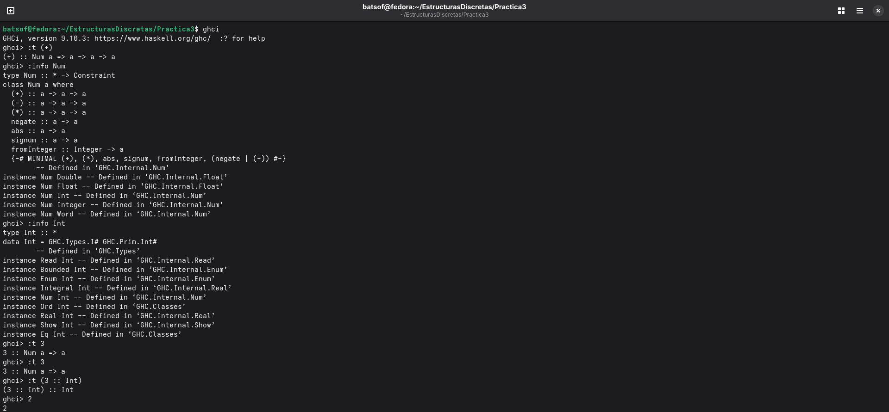

Descripcion: README de la practica 3 
Autora: Sofia Hernandez Lopez

Int - es un entero de tamanio fijo, 64 bits en la ayoria de sisstemas 
Num- es una clase de tipos (operaciones como +,*,abs) que Int, Integer, Float, Double lo implementan 
Int es una instancia de Num 

