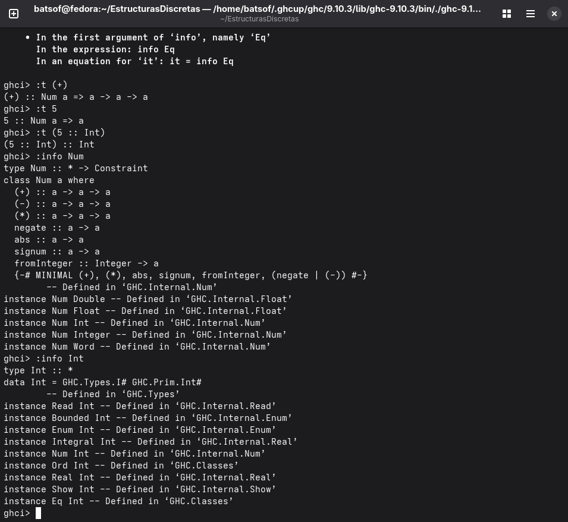

The Glorious Glasgow Haskell Compilation System, version 9.10.3
# EstructurasDiscretas

**Nombre:** Sofia Hernandez Lopez

**Descripción:**  Repositorio con las prácticas y proyecto de la asignatura Estructuras Discretas

**Versión de GHC:** `The Glorious Glasgow Haskell Compilation System, version 9.10.3`

**Diferencia entre Num e Int**  

-Int es un tipo concreto: un entero de tama;o fijo (64 bits) 

-Num es una clase de tipos: un conjunto de operaciones (+,-,*,...)

En resumen: Int es un tipo, Num es una familia de tipos

